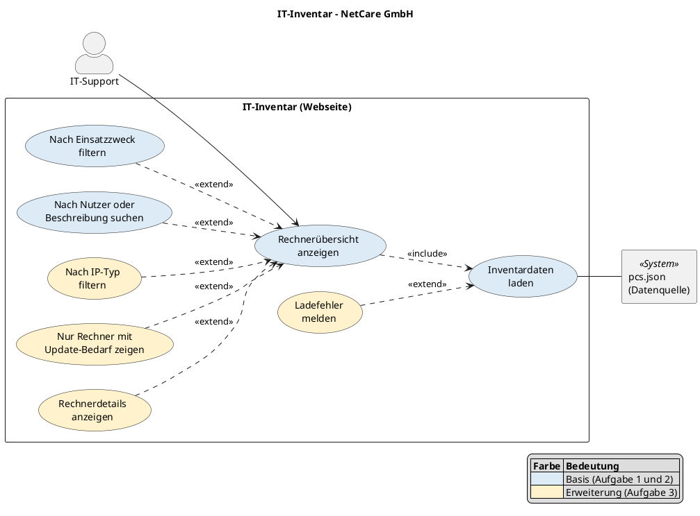
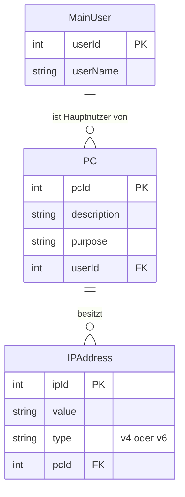

# IT-Inventar – Frontend-Übung mit der Fetch-API


## Ausgangssituation

Das Systemhaus **NetCare GmbH** liefert Computer an Geschäftskunden aus. Auf jedem ausgelieferten Rechner wird ein Dienst installiert, über den sich per REST-API Informationen zum Computer abfragen lassen: Einsatzzweck, Hauptnutzer und IP-Adressen.

Für den Kunden **Brenner Logistik GmbH** wurden die Antworten aller Rechner bereits eingesammelt und in der Datei `data/pcs.json` zusammengeführt.

Der **First-Level-Support** der NetCare GmbH benötigt eine übersichtliche Webseite. Ruft eine Mitarbeiterin des Kunden an („Mein PC startet nicht“), soll der zuständige Rechner schnell gefunden werden. Dazu gehört, wem er gehört und unter welchen IP-Adressen er für die Fernwartung erreichbar ist.

### User Stories

- Als Supporter möchte ich **alle Rechner in einer Tabelle** sehen, um einen Überblick zu erhalten.
- Als Supporter möchte ich nach **Einsatzzweck** filtern, um z. B. alle Office-Rechner für ein Update zu planen.
- Als Supporter möchte ich nach einem **Nutzernamen oder einer Beschreibung suchen**, um den Rechner eines Anrufers zu finden.
- *(Erweiterung)* Als Netzwerkadmin möchte ich **nur IPv4- oder nur IPv6-Adressen** sehen.
- *(Erweiterung)* Als Admin möchte ich Rechner mit dem Vermerk **„Updaten!“** auf einen Blick erkennen.

---

### Anwendungsfalldiagramm



## Bereitgestellte Dateien

`data/pcs.json` – Daten von 16 Rechnern


---

## Datenmodell

### Datenformat (Auszug aus `data/pcs.json`)

Die Datei enthält ein **Array**. Jedes Element umhüllt die Daten eines Rechners mit dem Schlüssel `PC_DATA`. 

```json
[
  {
    "PC_DATA": {
      "pcId": 494,
      "Description": "PC in der Abteilung Software.",
      "Purpose": "Development",
      "MainUser": {
        "userId": 12,
        "userName": "Anita Scheurenbrandt"
      },
      "IPAddresses": [
        { "Value": "192.168.0.23/24", "Type": "v4" },
        { "Value": "2012:65:fd85:5712:e0ca:9e76:661f:c4f1", "Type": "v6" }
      ]
    }
  }
]
```

> **Achtung:** Die Schlüssel sind uneinheitlich benannt (`pcId` (CamelCase) gegenüber `Description`, `Value`, (PascalCase) …). Solche Daten aus fremden Systemen sind in der Praxis üblich. Es empfiehlt sich, sie nach dem Laden **einmalig in ein eigenes, einheitliches Format umzuwandeln** (siehe Aufgabe 1).

### Entity-Relationship-Diagramm

Für eine spätere Speicherung in einer relationalen Datenbank wurde folgendes ERD entworfen:



| Beziehung | Kardinalität | Bedeutung |
|---|---|---|
| MainUser – PC | 1 : n | Ein Rechner hat genau einen Hauptnutzer. Ein Nutzer kann Hauptnutzer mehrerer Rechner sein. |
| PC – IPAddress | 1 : n | Ein Rechner kann keine, eine oder mehrere IP-Adressen besitzen. Jede Adresse gehört zu genau einem Rechner. |

`ipId` kommt im JSON nicht vor. Es handelt sich um einen **künstlichen Schlüssel** (Surrogatschlüssel), der erst in der Datenbank vergeben wird.


---

## Aufgabe 1 – Daten laden und als Tabelle ausgeben 


1. Die Datei `data/pcs.json` mit der **Fetch-API** laden (`fetch` und  `response.json()`, vielleicht mit `async`/`await` oder `Promise-Chaining` (`.then`)).
2. Die Rohdaten **einmalig umwandeln** (`map`) in ein einheitliches Format, z. B.:

   ```js
   { id, description, purpose, user: { id, name }, ips: [ { value, type } ] }
   ```
3. Die umgewandelten Daten in einer **Variablen** (Array) für die weitere Verwendung vorhalten.
4. Alle Rechner in einer **HTML-Tabelle** ausgeben (siehe Wireframe 1) mit den Spalten:
   - PC-Nr.
   - Beschreibung
   - Zweck
   - Hauptnutzer
   - IP-Adressen (alle Adressen eines Rechners in **einer** Zelle, z. B. als Liste)
5. Rechner ohne IP-Adresse zeigen in der IP-Spalte einen Hinweis wie „– keine –“.
6. Tabellenzeilen per JavaScript erzeugen (`createElement`, `textContent` oder mit `template`) . Auf `innerHTML` mit Daten aus der JSON-Datei eher verzichten.
7. Die Seite semantisch aufbauen (`header`, `main`, `footer`) und mit CSS ansprechend gestalten: Tabellenrahmen, Abstände, Zebra-Streifen, hervorgehobener Tabellenkopf.

**Kontrolle:** 16 Tabellenzeilen. Der Rechner 620 hat keine IP-Adresse.

---

## Aufgabe 2 – Filtern nach Einsatzzweck und Freitextsuche 

1. Eine **Filterleiste** oberhalb der Tabelle ergänzen (siehe Wireframe 1):
   - **Auswahlliste** (`<select>`) „Einsatzzweck“ mit der ersten Option **„Alle“**
   - **Suchfeld** (`<input type="search">`) für Nutzername oder Beschreibung
   - Jedes Steuerelement erhält ein zugehöriges `<label>`.
2. Die Optionen der Auswahlliste **nicht fest in HTML schreiben**, sondern **aus den Daten erzeugen**. Jeder Einsatzzweck soll dabei genau einmal vorkommen (Tipp: `Set` – siehe Links unten).
3. Die Tabelle aktualisiert sich **sofort** bei jeder Änderung:
   - Auswahlliste: Ereignis `change`
   - Suchfeld: Ereignis `input`. Die Suche unterscheidet nicht zwischen Groß- und Kleinschreibung.
4. Beide Filter wirken **gemeinsam** (UND-Verknüpfung).
5. Über der Tabelle steht ein **Trefferzähler**, z. B. „8 von 16 Rechnern“.
6. Liefert der Filter keine Treffer, erscheint der Hinweis „Keine Rechner gefunden.“ anstelle einer leeren Tabelle.

> **Architektur-Hinweis:** Die Daten werden **nur einmal** geladen. Jeder Filtervorgang arbeitet auf dem bereits geladenen Array (`filter`) und ruft danach **eine** zentrale Funktion zum Neuzeichnen der Tabelle auf, z. B. `render(liste)`.

**Kontrollwerte:**

| Einstellung | Treffer |
|---|---|
| Zweck „Office“ | 8 |
| Zweck „Development“ | 4 |
| Suche „brenner“ | 3 |
| Zweck „Office“ + Suche „brenner“ | 1 (PC 700) |
| Suche „updaten“ | 4 |

---

## Aufgabe 3 – Erweiterungen (optional)

Die Teilaufgaben sind unabhängig voneinander und in beliebiger Reihenfolge bearbeitbar.

### 3.1 IP-Typ per Radiobuttons

- Drei **Radiobuttons** mit gemeinsamem `name`: „Alle“ (vorausgewählt), „nur IPv4“, „nur IPv6“
- Gruppierung mit `<fieldset>` und `<legend>` „IP-Typ“
- Bei „nur IPv4“ bzw. „nur IPv6“ gilt:
  - Angezeigt werden nur Rechner mit **mindestens einer** Adresse dieses Typs.
  - In der IP-Spalte erscheinen nur Adressen dieses Typs.
- Wirkt zusammen mit den Filtern aus Aufgabe 2.

**Kontrolle:** nur IPv4 → 15 Rechner, nur IPv6 → 10 Rechner

### 3.2 Checkbox „Nur Update nötig“

- **Checkbox**, die nur Rechner zeigt, deren Beschreibung „Updaten!“ enthält
- Unabhängig vom Filter werden diese Zeilen **immer farblich hervorgehoben**, über eine CSS-Klasse wie `.update-noetig`. Inline-Styles werden nicht verwendet.

**Kontrolle:** 4 Rechner (152, 201, 403, 499)

### 3.3 Detailansicht

- Ein Klick auf eine Tabellenzeile öffnet eine **Detailansicht** (siehe Wireframe 2), z. B. mit `<dialog>`:
  - alle Daten des Rechners
  - IP-Adressen **getrennt nach IPv4 und IPv6**
  - weitere Rechner desselben Hauptnutzers (1:n-Beziehung aus dem ERD)
- Schließen per Button und per `Esc`
- Tipp: Ein `data-id`-Attribut an der Zeile und ein einziger Klick-Listener an `<tbody>` (Event Delegation) genügen.


### 3.4 Responsives Layout

- Auf schmalen Bildschirmen (< 700 px) werden statt der Tabelle **Karten** untereinander angezeigt (siehe Wireframe 3).
- Umsetzung mit Media Query sowie Flexbox oder Grid

---

## Wireframes

### Wireframe 1 – Übersicht (Aufgaben 1, 2, 3.1, 3.2)

```text
┌────────────────────────────────────────────────────────────────────────────────────────────────────┐
│  NetCare GmbH · IT-Inventar                                          Kunde: Brenner Logistik GmbH  │
├────────────────────────────────────────────────────────────────────────────────────────────────────┤
│                                                                                                    │
│  Einsatzzweck              Suche                                                                   │
│  ┌─────────────────┬───┐   ┌──────────────────────────────────┐                                    │
│  │ Alle            │ ▼ │   │ Name oder Beschreibung …         │                                    │
│  └─────────────────┴───┘   └──────────────────────────────────┘                                    │
│                                                                                                    │
│  ┌ IP-Typ ──────────────────────────────┐   ┌───────────────────────────┐                          │
│  │ (●) Alle  ( ) nur IPv4  ( ) nur IPv6 │   │ [ ] Nur „Update nötig“    │                          │  ← 3.1 / 3.2 (optional)
│  └──────────────────────────────────────┘   └───────────────────────────┘                          │
│                                                                                                    │
│  8 von 16 Rechnern                                                                                 │
│  ┌────────┬────────────────────────────┬─────────────┬──────────────────────┬────────────────────┐ │
│  │ PC-Nr. │ Beschreibung               │ Zweck       │ Hauptnutzer          │ IP-Adressen        │ │
│  ├────────┼────────────────────────────┼─────────────┼──────────────────────┼────────────────────┤ │
│  │ 494    │ PC in der Abteilung Soft…  │ Development │ Anita Scheurenbrandt │ 192.168.0.23/24    │ │
│  │        │                            │             │                      │ 2012:65:fd85:…     │ │
│  ├────────┼────────────────────────────┼─────────────┼──────────────────────┼────────────────────┤ │
│  │  152   │ Im First level support. U… │ Office      │ Esra Hiliam          │ 192.168.0.20/24 …  │ │  ← hervorgehoben (3.2)
│  ├────────┼────────────────────────────┼─────────────┼──────────────────────┼────────────────────┤ │
│  │ 620    │ Lager, Scanner-Station …   │ Office      │ Kemal Arslan         │ – keine –          │ │
│  ├────────┼────────────────────────────┼─────────────┼──────────────────────┼────────────────────┤ │
│  │ …      │ …                          │ …           │ …                    │ …                  │ │
│  └────────┴────────────────────────────┴─────────────┴──────────────────────┴────────────────────┘ │
│                                                                                                    │
├────────────────────────────────────────────────────────────────────────────────────────────────────┤
│  © NetCare GmbH · Datenstand: data/pcs.json                                                        │
└────────────────────────────────────────────────────────────────────────────────────────────────────┘
```

### Wireframe 2 – Detailansicht als Dialog (Aufgabe 3.3)

```text
          ┌──────────────────────────────────────────────────┐
          │  PC 494                                     [X]  │
          ├──────────────────────────────────────────────────┤
          │  Beschreibung:  PC in der Abteilung Software.    │
          │  Zweck:         [Development]                    │
          │  Hauptnutzer:   Anita Scheurenbrandt (ID 12)     │
          │                                                  │
          │  IPv4                                            │
          │   • 192.168.0.23/24                              │
          │  IPv6                                            │
          │   • 2012:65:fd85:5712:e0ca:9e76:661f:c4f1        │
          │   • 2012:65:fd85:5712:fdf4:11ed:9aba:9e27        │
          │                                                  │
          │  Weitere Rechner von Anita Scheurenbrandt:       │
          │   • PC 495 – Testrechner für Build-Prozesse …    │
          │                                                  │
          │                                  [ Schließen ]   │
          └──────────────────────────────────────────────────┘
```

### Wireframe 3 – Kartenansicht auf schmalen Bildschirmen (Aufgabe 3.4)

```text
┌────────────────────────────────┐
│ NetCare · IT-Inventar          │
├────────────────────────────────┤
│ Einsatzzweck [ Alle       ▼]   │
│ Suche [ Name …            ]    │
│ IP-Typ (●)Alle ( )v4 ( )v6     │
│ [ ] Nur „Update nötig“         │
│ 16 von 16 Rechnern             │
│ ┌────────────────────────────┐ │
│ │ PC 494       [Development] │ │
│ │ PC in der Abteilung …      │ │
│ │ Anita Scheurenbrandt       │ │
│ │ 192.168.0.23/24            │ │
│ │ 2012:65:fd85:5712:…        │ │
│ └────────────────────────────┘ │
│ ┌────────────────────────────┐ │
│ │ PC 152  [Office]  ! Update │ │
│ │ Im First level support …   │ │
│ │ Esra Hiliam                │ │
│ │ …                          │ │
│ └────────────────────────────┘ │
└────────────────────────────────┘
```

---

## Anhang – Hilfreiche Links


### Daten laden (Fetch-API, JSON)

| Thema | W3Schools | MDN |
|---|---|---|
| Fetch-API | [JS Fetch API](https://www.w3schools.com/js/js_api_fetch.asp) | [Fetch verwenden](https://developer.mozilla.org/de/docs/Web/API/Fetch_API/Using_Fetch) |
| async / await | [JS Async/Await](https://www.w3schools.com/js/js_async.asp) | [async function](https://developer.mozilla.org/de/docs/Web/JavaScript/Reference/Statements/async_function) |
| JSON | [JS JSON](https://www.w3schools.com/js/js_json.asp) | [Response.json()](https://developer.mozilla.org/de/docs/Web/API/Response/json) |
| Antwort prüfen | – | [Response.ok](https://developer.mozilla.org/de/docs/Web/API/Response/ok) |
| Fehlerbehandlung | [JS Errors (try/catch)](https://www.w3schools.com/js/js_errors.asp) | [try...catch](https://developer.mozilla.org/de/docs/Web/JavaScript/Reference/Statements/try...catch) |
| Warum Live Server? | – | [CORS](https://developer.mozilla.org/de/docs/Web/HTTP/CORS) |

### Arrays und Daten verarbeiten

| Thema | W3Schools | MDN |
|---|---|---|
| map / filter / some | [Array Iteration](https://www.w3schools.com/js/js_array_iteration.asp) | [map](https://developer.mozilla.org/de/docs/Web/JavaScript/Reference/Global_Objects/Array/map) · [filter](https://developer.mozilla.org/de/docs/Web/JavaScript/Reference/Global_Objects/Array/filter) · [some](https://developer.mozilla.org/de/docs/Web/JavaScript/Reference/Global_Objects/Array/some) |
| Set (eindeutige Werte) | [JS Sets](https://www.w3schools.com/js/js_sets.asp) | [Set](https://developer.mozilla.org/de/docs/Web/JavaScript/Reference/Global_Objects/Set) |
| Strings durchsuchen | [String Search](https://www.w3schools.com/js/js_string_search.asp) | [includes](https://developer.mozilla.org/de/docs/Web/JavaScript/Reference/Global_Objects/String/includes) · [toLowerCase](https://developer.mozilla.org/de/docs/Web/JavaScript/Reference/Global_Objects/String/toLowerCase) |
| Destructuring | [JS Destructuring](https://www.w3schools.com/js/js_destructuring.asp) | [Destrukturierende Zuweisung](https://developer.mozilla.org/de/docs/Web/JavaScript/Reference/Operators/Destructuring_assignment) |
| Template-Literals | [JS Template Strings](https://www.w3schools.com/js/js_string_templates.asp) | [Template literals](https://developer.mozilla.org/de/docs/Web/JavaScript/Reference/Template_literals) |

### DOM und Ereignisse

| Thema | W3Schools | MDN |
|---|---|---|
| Elemente erzeugen | [DOM Elements (Nodes)](https://www.w3schools.com/js/js_htmldom_nodes.asp) | [createElement](https://developer.mozilla.org/de/docs/Web/API/Document/createElement) · [append](https://developer.mozilla.org/de/docs/Web/API/Element/append) |
| Text setzen | – | [textContent](https://developer.mozilla.org/de/docs/Web/API/Node/textContent) |
| Event-Listener | [addEventListener](https://www.w3schools.com/js/js_htmldom_eventlistener.asp) | [addEventListener](https://developer.mozilla.org/de/docs/Web/API/EventTarget/addEventListener) |
| Ereignisse `input` / `change` | [oninput](https://www.w3schools.com/jsref/event_oninput.asp) · [onchange](https://www.w3schools.com/jsref/event_onchange.asp) | [input-Event](https://developer.mozilla.org/de/docs/Web/API/Element/input_event) · [change-Event](https://developer.mozilla.org/de/docs/Web/API/HTMLElement/change_event) |
| data-Attribute | [data-*](https://www.w3schools.com/tags/att_data-.asp) | [dataset](https://developer.mozilla.org/de/docs/Web/API/HTMLElement/dataset) |
| CSS-Klassen setzen | [classList](https://www.w3schools.com/jsref/prop_element_classlist.asp) | [classList](https://developer.mozilla.org/de/docs/Web/API/Element/classList) |

### HTML-Elemente

| Thema | W3Schools | MDN |
|---|---|---|
| Tabelle | [HTML Tables](https://www.w3schools.com/html/html_tables.asp) | [&lt;table&gt;](https://developer.mozilla.org/de/docs/Web/HTML/Element/table) |
| Formular-Elemente allgemein | [HTML Form Elements](https://www.w3schools.com/html/html_form_elements.asp) | [Web-Formulare](https://developer.mozilla.org/de/docs/Learn/Forms) |
| Auswahlliste | [&lt;select&gt;](https://www.w3schools.com/tags/tag_select.asp) | [&lt;select&gt;](https://developer.mozilla.org/de/docs/Web/HTML/Element/select) |
| Radiobuttons | [input type="radio"](https://www.w3schools.com/tags/att_input_type_radio.asp) | [&lt;input type="radio"&gt;](https://developer.mozilla.org/de/docs/Web/HTML/Element/input/radio) |
| Checkbox | [input type="checkbox"](https://www.w3schools.com/tags/att_input_type_checkbox.asp) | [&lt;input type="checkbox"&gt;](https://developer.mozilla.org/de/docs/Web/HTML/Element/input/checkbox) |
| Suchfeld | [input type="search"](https://www.w3schools.com/tags/att_input_type_search.asp) | [&lt;input type="search"&gt;](https://developer.mozilla.org/de/docs/Web/HTML/Element/input/search) |
| Beschriftung | [&lt;label&gt;](https://www.w3schools.com/tags/tag_label.asp) | [&lt;label&gt;](https://developer.mozilla.org/de/docs/Web/HTML/Element/label) |
| Gruppierung | [&lt;fieldset&gt;](https://www.w3schools.com/tags/tag_fieldset.asp) | [&lt;fieldset&gt;](https://developer.mozilla.org/de/docs/Web/HTML/Element/fieldset) |
| Dialog | [&lt;dialog&gt;](https://www.w3schools.com/tags/tag_dialog.asp) | [&lt;dialog&gt;](https://developer.mozilla.org/de/docs/Web/HTML/Element/dialog) |
| Semantische Elemente | [HTML Semantics](https://www.w3schools.com/html/html5_semantic_elements.asp) | [HTML-Elementreferenz](https://developer.mozilla.org/de/docs/Web/HTML/Element) |

### CSS

| Thema | W3Schools | MDN |
|---|---|---|
| Tabellen gestalten | [CSS Tables](https://www.w3schools.com/css/css_table.asp) | [Tabellen stylen](https://developer.mozilla.org/de/docs/Learn/CSS/Building_blocks/Styling_tables) |
| Zebra-Streifen | [:nth-child()](https://www.w3schools.com/cssref/sel_nth-child.php) | [:nth-child()](https://developer.mozilla.org/de/docs/Web/CSS/:nth-child) |
| Flexbox | [CSS Flexbox](https://www.w3schools.com/css/css3_flexbox.asp) | [Flexbox](https://developer.mozilla.org/de/docs/Learn/CSS/CSS_layout/Flexbox) |
| Grid | [CSS Grid](https://www.w3schools.com/css/css_grid.asp) | [Grid-Layout](https://developer.mozilla.org/de/docs/Web/CSS/CSS_grid_layout) |
| Media Queries | [Responsive – Media Queries](https://www.w3schools.com/css/css_rwd_mediaqueries.asp) | [Media Queries verwenden](https://developer.mozilla.org/de/docs/Web/CSS/CSS_media_queries/Using_media_queries) |
